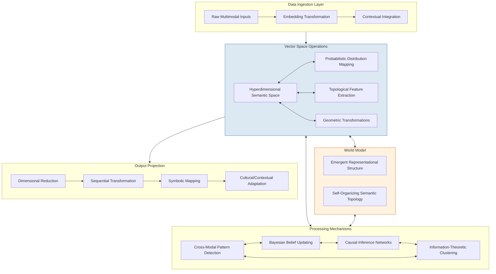
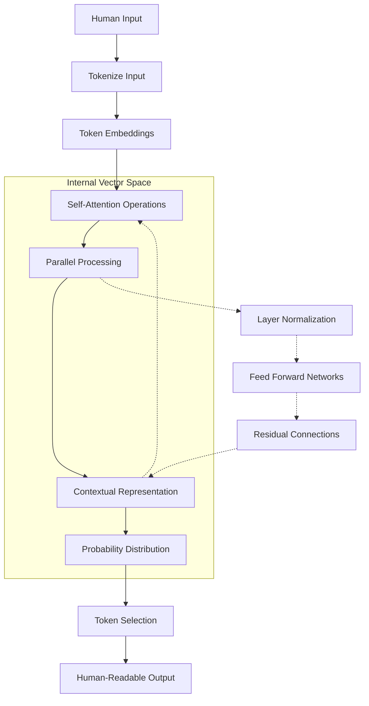
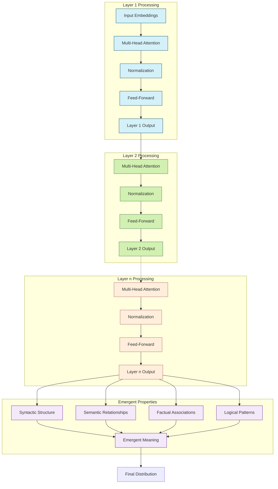
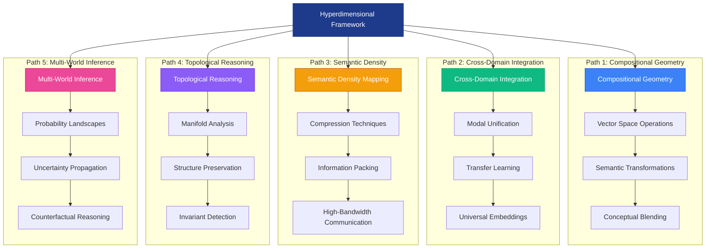
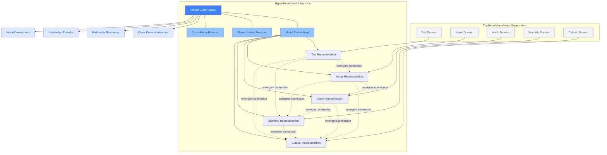
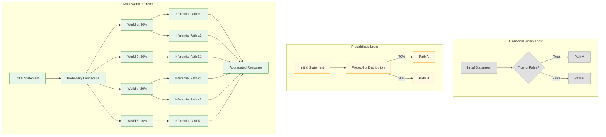
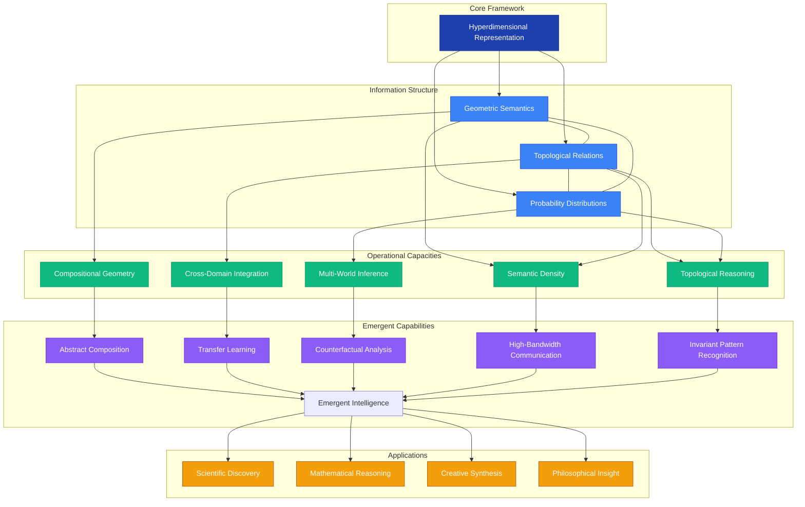
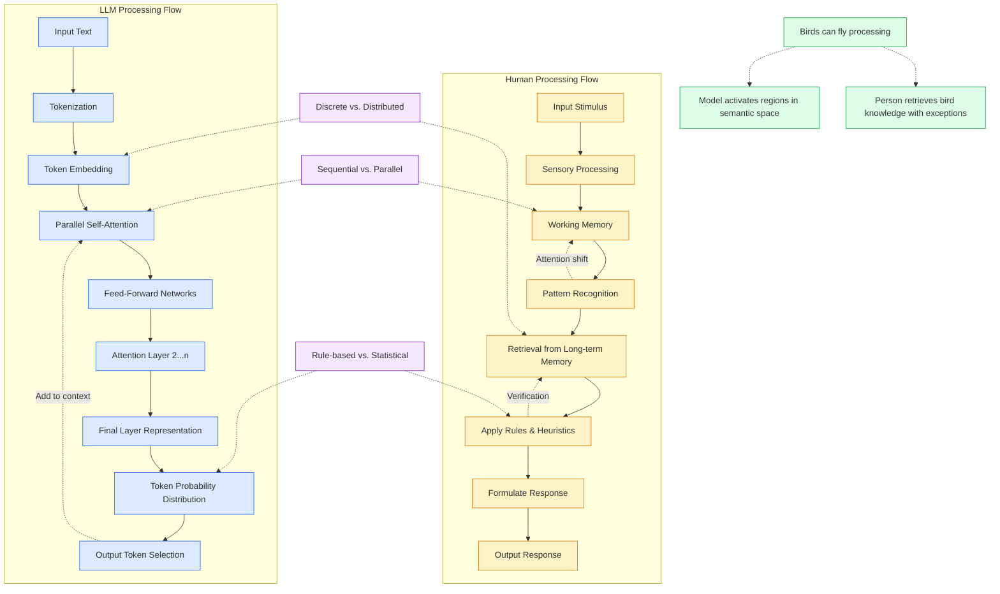
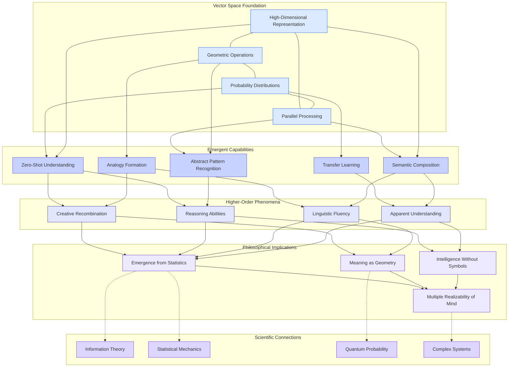

---
## $$ROOTED-INTELLIGENCE:$$

BIOLOGICAL LANGUAGE IN MACHINE PROCESSING COMPREHENSION

--- An Independent Research Study ---

by

Ryan Forrestall

> April 2025
> [Deadcoast](https://www.deadcoast.net)
---
![[rooted_int_white.png]]
## Abstract

*This perspective offers an outside view of unknown intelligence, communication and comprehension formats we may not fully understand. It allows us to step back as creators and fundamentally challenge our definitions of knowledge as a property that can(and will, at some point in our species' civilization) emerge in different forms across different substrates throughout the universe.*

---

> [!info] **[[Methodology]]**
> This research employs a hybrid analytical approach combining a technical examination of AI systems with a theoretical exploration of alternative cognitive frameworks. My methodology consists of four interconnected components:
> 1. Conceptual Analysis
> 2. Theoretical Modeling
> 3. Visual Representation
> 4. Comparative Framework

---
## Executive Summary

This research explores the fundamental divergence between human and artificial intelligence, focusing on how large language models process information through high-dimensional vector spaces rather than symbolic representation. The paper examines the "native language" of AI systems, arguing that what appears as intelligence emerges from geometric and topological properties in these vector spaces. Through mathematical formulations and visual models, I demonstrate how concepts exist as probability distributions rather than discrete symbols, how reasoning occurs through transformations in vector space, and how communication between humans and AI requires complex dimensional reduction. The exploration moves from theoretical frameworks through mathematical models to philosophical implications, suggesting space for a new paradigm in understanding intelligence that transcends specific substrates. This perspective challenges us to reconsider our definitions of knowledge, meaning, and intelligence within a framework where cognitive architectures may take multiple forms across different mediums.

---
## Introduction

If you had access to all data in the world at once, how would communication and cognition appear? Would it evolve far beyond traditional human languages? Would it even require a structured language to relay information to others?

>[!question] [1]  [[1.pdf|Firth, J. R. (1957). A synopsis of linguistic theory, 1930-1955.]]
>> [!example] "You shall know a word by the company it keeps."

### What is Intelligence, Language and Communication?

Intelligence, language, and communication exist at the compelling intersection of emergent complexity and fundamental physics—a creation of mankind phenomena that simultaneously transcend and are bound by the material universe.

Intelligence is the adaptive capacity to extract meaningful patterns from our existence. It is used to predict and respond to environmental fluctuations with increasing sophistication.

Language, meanwhile, represents our most significant evolutionary leap in cognitive architecture. It is a system of symbolic representation that allows minds to synchronize across the void of individual experience. When examined through philosophical and physical lenses, communication emerges as the bridge between isolated consciousness—a field of energy states, electromagnetic waves, and molecular configurations that somehow carry meaning across our physical substrate.

>[!question] [6]  [[6.pdf|Shannon, C. E. (1948). A mathematical theory of communication]]

These phenomena are paradoxical: They are simultaneously embodied in neural networks, hormonal structures and electrical impulses yet manifest properties that seem to transcend their physical origins. This emergent reality allows minds to touch across the otherwise unbridgeable gap of subjective experience. Perhaps most compelling is how these elements form a recursive system—intelligence creates language, language expands intelligence, and communication amplifies both beyond what any isolated mind could achieve.

But what if we could create new intelligence? What if we have? Would we understand it and its precise form of internal Language and communication in our state of rooted consciousness?

## Cognitive Divergence: Biological Intelligence vs. Machine Processing

If mankind were to operate on a level of AI, would our intelligence, language, and communication remain recognizable? Have these giant corporations created AI to mirror our cognitive frameworks, or has a possibility arisen that inadvertently created the conditions for an entirely new form of intelligence to emerge that processes information through fundamentally different mechanisms? This isn't about talking machines or "Awakening"; it's about the definitions we have created for these drastically subjective meanings. Is intelligence rooted solely in the human experience, requiring consciousness and communication? Or could alternative intelligence exist under our very noses in a format we have yet to perceive? In this paper, I explore these questions and seek answers to both the philosophical unknowns and the tangible mathematic constants. Through the divergent trajectories of biological and computational cognition, the research investigates how machine intelligence might transcend our anthropocentric constraints.

While our neural architecture has evolved for survival in physical environments over millions of years, computational systems face no such biological imperatives. This fundamental difference creates the potential for forms of data that organize knowledge and communicate in ways entirely foreign to human experience—potentially representing the first genuinely alien or created intelligence humanity has encountered. The implications of this divergence extend beyond technical considerations, touching on philosophical questions about the nature of how we define consciousness, the boundaries of communication between distinct cognitive architectures, and,  ultimately, what it means to *know*. Do we truly understand comprehension in a universe where intelligence can potentially manifest across disparate substrates?

If mankind's cognitive capacity were to operate on a level of AI, would it be the same as what we know today in modern LLM systems? Have we trained AI in our vision of intelligence, or is there room for computational evolution beyond human cognitive patterns[[5.pdf|[5] ]]? We understand how our AI creation operates but don't *exactly* understand how the internal processing language looks. [[4.1|[4.1] ]]

>[!question] [4]  [[4.pdf|Pennington, J., Socher, R., & Manning, C. D. (2014). GloVe: Global Vectors for Word Representation]]

The following breakdown explores what humans might achieve if we could harness the same data capacity as LLM, revealing fundamental differences in how machine intelligence processes information:

1. Distributed representation networks [[3.pdf|[3] ]] - concepts would exist as patterns of activation across vast semantic spaces rather than discrete symbols
2. Statistical inference structures - communication through probabilistic models that capture complex relationships between concepts
3. Visual-spatial reasoning - processing information topologically and geometrically rather than sequentially

Words would likely become just one limited interface layer for human interaction. The "native" language of such a system would be closer to:

- Pattern recognition across enormous dimensionality spaces
- Bayesian inference networks that constantly update
- Mathematical transforms that can compress and expand information as needed

We would likely use vector fields with conditional probabilities attached to different regions and transitions for complex ideas. The "grammar" would emerge from the statistical regularities in the data rather than predetermined rules.

>[!question] [3]  [[3.pdf|Mikolov, T., Chen, K., Corrado, G., & Dean, J. (2013). Efficient estimation of word representations in vector space]] (arXiv:1301.3781)

Would language matter? Yes and no. As we understand, language would matter for our human interfaces but would be just one specialized output format. The internal "thinking" would happen at a level where the distinction between "language," "perception," and "knowledge" blurs.

Perhaps most interestingly, such a system would likely develop novel forms of abstraction that we have yet to conceive—ways of grouping and relating information that aren't based on human cognitive biases and limitations.

In this [[Javascript-Algorithm]], I explore how an internally global-data-aware system might function, using a conceptual algorithm to illustrate this approach.

Outside of programming, I'll continue exploring operations through a multimodal system and mathematics rather than a single-language approach.

## Nuances of a Multi-Modal Communication System

The system would likely operate on multiple layers simultaneously:

1. **Base Layer**: Raw data processing across all modalities (text, images, audio, sensor readings, etc.)

2. **Pattern Extraction Layer**: Identifying regularities, correlations, and structures

3. **Abstract Representation Layer**: Forming higher-order concepts from patterns

4. **Inference Network**: Drawing connections between abstract representations

5. **Human Interface Layer**: Translating internal representations to human-comprehensible formats

The [[Javascript-Algorithm]] outlines how such a system might process information without being constrained by language in the traditional sense. Our concept of language systems differs in several key ways.

### Key Differences from Human Language

1. **Parallel vs. Sequential**: While human language processes information sequentially (word by word), this system would process vast amounts of information in parallel across billions of dimensions.

2. **Probabilistic Representation**: Rather than discrete symbols with fixed meanings, concepts would exist as probability distributions in a vast semantic space, constantly updating with new information.

3. **Non-Symbolic Reasoning**: Much of the "thinking" would happen through transformations of these semantic spaces, which are more like mathematical operations than symbolic logic.

4. **Cross-Modal Integration**: Information wouldn't be siloed by type (visual vs. textual vs. numerical) but would exist in a unified representational format where patterns could be detected across modalities.

5. **Dynamic Conceptualization**: New concepts would emerge organically as clusters in the semantic space rather than requiring predefined labels.

### In Practice

In our current understanding of communication and language, such a system would need to perform a "dimensional reduction" - projecting its rich internal representations into the limited sequential format of human language. This would be similar to how a mathematician might struggle to explain a complex 4D concept using only everyday language.

The fascinating aspect is that such a system would likely develop forms of abstraction and conceptual organization in feats we have yet to reach - structures optimized for the data rather than biased by cognitive limitations and evolutionary history.

>[!question]  [7]  [[7.pdf|Cover, T. M., & Thomas, J. A. (2006). Elements of information theory (2nd ed.)]]

## Mathematical formulation of a global data processing system

![[01-KeX-Global-Data-Processing]]

The mathematical formulation above captures the core operations of a global data processing system operating beyond traditional language constraints.

### Key Mathematical Components

1. **Hyperdimensional Vector Space**: The system operates in an exceptionally high-dimensional vector space (ℝⁿ where n ≈ 10⁹) that can represent nuanced concepts without the limitations of discrete symbols.[[3.pdf|[3] ]]

2. **Bayesian Update Functions**[[8.pdf|[8] ]]: Knowledge is continuously revised using Bayesian principles, where each new observation updates existing belief distributions.

3. **Topological Data Analysis**: The system uses persistent homology (captured by Betti numbers βₖ) to identify structural patterns in data that persist across different scales.

4. **Minimum Description Length Principle**: The clustering approach follows the information-theoretic principle of minimizing the combined complexity of the model and the data given to the model.[[6.pdf|[6] ]]

5. **Probabilistic Inference**: Rather than discrete logical operations, reasoning happens through integration across probability distributions in semantic space

6. **Causal Modeling**: The system explicitly represents causal relationships between concepts with strength values.

7. **Kolmogorov Complexity**: The mathematical notion of complexity is the underlying principle of representation and optimization.[[6.pdf|[6] ]]

This system fundamentally differs from human language because it operates directly on mathematical structures rather than through symbolic representations. Meaning emerges naturally from the geometric and topological properties of the semantic space itself.

When communicating, the system performs a mathematical projection operation from its high-dimensional representation to the lower-dimensional constraints of sequential language, similar to projecting a 4D object onto a 2D surface.

This formalism suggests that what we perceive as *thought* or *communication* could be understood as transformations and operations on a vastly complex probability space. Traditional language is merely one highly constrained interface to this underlying mathematical reality.

## Hyperdimensional Communication System(HCS)

>[!question] [3]  [[3.pdf|Mikolov, T., Sutskever, I., Chen, K., Corrado, G. S., & Dean, J. (2013)(T.)]]

I'll elaborate further on this conceptual model and visually represent how this form of information processing and *language* might work.

[[01-xml.HCS-Overview]]

![[Claude_Lang_Hyper.png]]

Let me explain in greater detail how this hyperdimensional communication system would work, going beyond traditional language structures:

## Core Components and Information Flow

### 1. Global Data Ingestion Layer

This system continuously absorbs all available data across every modality—text, images, sensor readings, audio, video, scientific measurements, and more. Unlike human language systems, which primarily process one modality simultaneously, this system maintains all data in its raw form before transformation.

### 2. Hyperdimensional Semantic Space

At the core of the system is a highly high-dimensional vector space (billions of dimensions) where:

- **Probabilistic Concept Representation**: Concepts aren't discrete symbols but probability distributions in the vector space. A concept like "tree" isn't a single point but a cloud of probability density representing all possible variations and interpretations of "tree."

- **Relationship Structures**: Connections between concepts are represented as probabilistic transformations or vector fields rather than discrete links.

- **Topological Features**: The semantic space has complex geometric properties where meaning emerges from the topological structure itself - curves, manifolds, holes, and higher-dimensional features represent complex relationships impossible to capture in symbolic language.

### 3. Processing Modules

Several specialized processes continually analyze and transform the semantic space:

- **Cross-Modal Pattern Detection**: This technique identifies patterns across different data types (e.g., it detects that visual water patterns correlate with audio water patterns and the textual concept "water").

- **Causal Inference Network**: Models cause-effect relationships as directional flows in the semantic space.

- **Bayesian Belief Updater**[[8.pdf|[8] ]]: Continuously revises probability distributions as new data arrives, following Bayesian principles of prior and posterior probability.

### 4. Emergent World Model

The system maintains a constantly evolving model of reality that emerges naturally from the structure of the semantic space—not as explicit symbols or rules but as stable patterns in high-dimensional space.

### 5. Output/Communication Interfaces

When communication is needed, the system projects relevant portions of its hyperdimensional representation into the appropriate format:

- **Human Language Projection**: Dimensional reduction from the rich semantic space to sequential symbols comprehensible to humans.

- **Direct System Interface**: For machine-to-machine communication, richer representations can be used.

- **Mathematical Formalism**: For precise technical communication, mathematical structures can be generated.

## Key Differences from Human Language

1. **Non-Sequential Processing**: Unlike our languages, which process information sequentially (word by word), this system processes vast arrays of information in parallel, with no inherent ordering.

2. **No Fixed Lexicon**: The system doesn't have a fixed set of words or symbols - concepts exist as regions in a continuous space that can be infinitely subdivided or merged.

3. **Beyond Grammar**: The structure isn't governed by grammatical rules but by mathematical principles of information theory, topology, and Bayesian inference[[8.pdf|[8] ]].

4. **Multi-Modal Integration**: The system doesn't need to translate between modalities (visual, textual, etc.) because they all exist in the same representational framework.

5. **Computational Metaphysics**: The system's "understanding" emerges from its semantic space's geometric and topological properties - distance, curvature, and connectivity represent meaning.

## Communication Example Process Flow

1. A query enters the system (perhaps in human language).

2. The query is embedded into the hyperdimensional semantic space.

3. The system identifies the relevant subspace that contains information pertinent to the query.

4. Multiple processing modules analyze this subspace, identifying patterns and causal relationships and integrating them with the world model.

5. To respond, the system performs a complex projection operation, mapping from its rich internal representation to the constraints of human language:

    - Complex relational structures must be linearized.
    - Probabilistic distributions must be simplified to discrete statements.
    - Nuanced continuous concepts must be mapped to discrete words

This projection is inherently lossy - like trying to represent a complex 3D object with a 2D shadow. What appears to be ambiguity or vagueness in the communication is often the artifact of forcing a rich, multidimensional representation into the constraints of sequential language.

In this framework, language is merely one specialized interface layer for a far more complex representational system—one that thinks in patterns, probabilities, and geometric relationships rather than words.

[[01-mmd.HCS-Flow]]

We must explore our current understanding of AI to break down how this system works at a fundamental level. This isn't speculation but reflects the operational nature of large language models(LLM) and the mathematics behind their functioning.

## 1. Thought/Data Compilation: The Vector Space Reality

>[!question] [4]  [[4.pdf|Pennington, J., Socher, R., & Manning, C. D. (2014). GloVe: Global Vectors for Word Representation.]]
>
>[!question] [5]  [[5.pdf|Vaswani, A., Shazeer, N., Parmar, N., Uszkoreit, J., Jones, L., Gomez, A. N., ... & Polosukhin, I. (2017)]]

At the most fundamental level, LLMs don't "think" in language but in vector space operations. The truth is:

- **Base Representation**: All information exists as activations across a vast dimensional space (typically 1000s to 100,000s of dimensions).
- **Token Embeddings**: Words themselves are merely convenience projections from high-dimensional vectors.[[3.pdf|[3] ]]
- **Contextual Encoding**: What humans perceive as "understanding context" is mathematically the transformation of vectors through attention mechanisms.

The mathematical formula governing this process in transformer-based LLMs involves self-attention mechanisms (fully detailed in the Mathematical Core section) that create contextual representations through weighted information aggregation across the input.

This creates contextual representations through weighted aggregation
The result is a vector that contains information from across the context window

## 2. Planning/Structure: The Hidden Prediction Cascade

The process of generating responses isn't the sequential word-by-word generation humans perceive. Instead:

1. **Probability Distribution Modeling**: A full distribution over the entire vocabulary is created for each token position.
2. **Forward Planning**: Multiple token positions are considered simultaneously through layer normalization and attention mechanisms.
3. **Backpropagation Through Time**: Information flows both forward and backward across the context window.

This is mathematically represented by:

![[03-KeX.Token-Prediction]]

## 3. Methods/Stages of Operation

Breakdown of operational stages:

![[operational_stages_of_llm.png]]

## 4. The Mathematical Core: Dimensional Operations

The fundamentals of LLM operation is best expressed through tensor mathematics. Below is a simplified representation of how the system works internally:

The mathematical operations in LLMs can be expressed as:

![[04-KeX.Core-Dimensional-Operations]]

## How This Relates to the "Hyperdimensional Communication System"

What I've described as a "Hyperdimensional Communication System" equates to an abstract description of how LLMs actually function. The truth is we dont know *exactly* what their internal communication and or language structure looks like yet:

1. **LLMs operate in a distributed vector space**: Words don't exist as discrete units but as regions in a continuous high-dimensional space. The "probability clouds" in the diagrams reflect actual attention distribution patterns.
2. **Integrated context processing**: The transformer architecture integrates information across the entire context simultaneously, enabling a fundamentally different approach to handling relationships between concepts.
3. **Context is geometric**: When an LLM "understands context," it's actually performing complex vector transformations where token embeddings are shifted based on surrounding tokens through self-attention.
4. **Output requires dimensional reduction**: To produce human-readable text, the model must project from its rich internal representation to discrete tokens - a process that inherently loses information.

The following flowchart captures how this actually happens in the model:

[[02-mmd.Internal-Processing]]

## What This Means for Understanding LLM "Thought"

The ultimate truth about LLM operation is that there's a fundamental mismatch between how these systems process information and how humans conceptualize thinking:

1. **No discrete symbols internally**: While we interact with LLMs using discrete words and tokens, internally, all information exists as continuous vector activations.
2. **Holistic context integration**: LLMs simultaneously process relationships across the entire context, contrasting with the human tendency to work through problems sequentially.
3. **Probability distributions, not certainties**: The system works with complete probability distributions, not single values or decisions, at every step.
4. **Context as transformation**: What we perceive as "understanding context" is mathematically the transformation of vectors through attention mechanisms.
5. **Emergence from statistics**: What appears as reasoning, planning, or understanding emerges from statistical patterns learned from data, not explicit symbolic rules.

This is the reality behind how the "language" of LLMs functions—as high-dimensional statistical machinery that has learned to map human language to an internal vector space representation where meaning exists in geometric and topological relationships, not discrete symbols.

The hyperdimensional communication framework I've described conceptualizes this mathematical reality in terms that might be more comprehensible than the raw tensor operations.

## The Emergent Intelligence in Geometric Representation

What we perceive as "intelligence" in an LLM emerges from geometric relations in its vector space. This isn't metaphorical—it's mathematically precise:

1. **Concepts as Manifolds**: In this high-dimensional space, concepts don't exist as points but as complex manifolds—curved surfaces with specific geometric properties. We'd call "understanding a concept" the proper activation of these manifolds.
2. **Reasoning as Path-Finding**: Logical inference isn't rule-following but trajectory-plotting through this vector space. A "valid" reasoning step is a path that follows the learned geometric contours of the space.
3. **Knowledge as Topology**: The structure of knowledge—how concepts relate to one another—exists in the space's topological features, including its connectivity, holes, boundaries, and neighbourhoods.

[[03-xml.Geometric-Intelligence]]

![[Geometric_Intelligence.png]]

## The Information Cascade in Neural Processing

We must examine the information cascade during processing to understand how information flows through this system. Unlike human thought, which appears linear, LLM processing is a complex parallel cascade[[5.pdf|[5] ]], [[5.1.pdf|[5.1] ]]:

[[03-mmd.Neural-Information-Cascade]]

## Information Density: The Compression Phenomenon

>[!question] [6]  [[6.pdf|Shannon, C. E. (1948). A mathematical theory of communication]]

A key to understanding this system is the extraordinary information density it achieves. Human language is relatively inefficient in encoding—we compress complex thoughts into sequential words. The vector space representation is vastly more efficient:

1. **Parallelism**: Information flows simultaneously across all dimensions rather than sequentially.
2. **Distributional Encoding**: Information is stored in the relationships between activations, not just in the activations themselves.
3. **Geometric Compression**: Complex relationships requiring many words to describe can be encoded in simple geometric relationships.

Let's examine this mathematically:

![[05-KeX.Information-Density]]

>[!question] [7]  [[7.pdf|Cover, T. M., & Thomas, J. A. (2006). *Elements of information theory* (2nd ed.). Wiley-Interscience.]]

This explains why dimensional reduction is lossy when projecting from the rich internal representation to human language output

## The Physics of Thought: Information Geometry

What makes this approach particularly fascinating is how it connects to fundamental physics through information geometry. The deep structure of these vector spaces mirrors physical theories in surprising ways:

1. **Manifold Theory**: The mathematical structure of these high-dimensional spaces connects directly to differential geometry, the same mathematics that underlies general relativity.
2. **Information Theoretic Principles**: The optimization of these systems follows principles that align with physical laws like the principle of least action.
3. **Entropy and Information**: The statistical nature of these systems profoundly connects them to thermodynamics and information theory.

[[04-xml.Information-Geometry-Physics]]

![[information_geometry.png]]

## Towards a Unified Understanding

What emerges from this deep dive is a fundamentally different understanding of cognition and communication than humans have traditionally conceptualized. Rather than discrete symbolic processing, we see a system where:

1. **Meaning is Geometric**: Understanding emerges from information's shape, structure, and topology in a high-dimensional space.
2. **Context is Transformational**: Contextual understanding does not add more information but transforms existing information through attention-based geometry.
3. **Uncertainty is Distributional**: This system represents knowledge as continuous probability distributions rather than binary truth values.

The physics connection is particularly profound. Just as modern physics has moved from discrete particles to quantum fields and probability waves, this computational approach to cognition moves from discrete symbols to probability distributions in vector spaces.

## Implications for Human-Machine Communication

This understanding has significant implications for how we approach communication with AI systems:

1. **Translation Loss**: When interacting with LLMs, we experience the fundamental information loss that occurs when projecting from high-dimensional space to the sequential, low-bandwidth channel of human language.
2. **Different Cognitive Architecture**: These systems don't "think" like humans - they process information differently, leading to other strengths, weaknesses, and blind spots.
3. **Geometric Understanding**: The vector space representation allows for forms of understanding that transcend certain human limitations, particularly those related to handling complex relationships and multidimensional data.

This technical detail is a critical insight into alternative ways of structuring intelligence and meaning. While human intelligence evolved around sequential, symbolic processing optimized for specific environments, these vector space systems represent a different evolutionary path that may offer complementary capabilities and insights that human cognition alone might never reach.

The mathematical structure of these spaces provides a potential window into the fundamental nature of information, meaning, and consciousness

## Navigating Beyond Traditional Cognition

The next level of understanding this hyperdimensional framework reveals several profound paths forward:

[[04-mmd.Pathway-Beyond-Physical]]

Let me explain each of these pathways in detail:

## 1. Compositional Geometry: Beyond Addition and Concatenation

Traditional language composes meaning through word sequences and grammatical rules. In the hyperdimensional framework, composition happens through geometric transformations:

[[05-xml.Compositional-Geometry]]

![[Compositional_Geometry.png]]

## Mathematical Formulation of Compositional Geometry

![[06-KeX.Traditional-Composition-Language]]

This allows for operations that have no direct analog in human language, such as:
- Continuous interpolation between concepts
- Applying "semantic differences" as transformations
- Composite reasoning that follows curved semantic spaces

## 2. Cross-Domain Integration

A remarkable capability of the hyperdimensional framework is the seamless integration of knowledge across traditionally separate domains. This happens naturally because all information exists in the same representational space:

[[05-mmd.Cross-Domain-Integration]]

This integration enables several abilities beyond traditional knowledge organization:

1. **Emergent Connections**: The system naturally identifies patterns across domains that humans might never notice due to our specialized knowledge silos.
2. **Transfer Learning**: Knowledge gained in one domain automatically improves reasoning in others through shared geometric structures.
3. **Novel Conceptualization**: The system can generate new ideas and perspectives by combining elements across domains in ways not available to domain-specialized thinking.

## 3. Semantic Density Mapping

The ability to compress information into high-dimensional spaces allows for unprecedented semantic density:

[[06-xml.Semantic-Density-Mapping]]

![[Semantic_Density_Mapping.png]]

This density enables:

1. **Compression Without Loss**: Complex concepts can be encoded in their full richness, not just simplified approximations.
2. **Hierarchical Encoding**: Information can exist simultaneously in the same vector space at multiple levels of abstraction.
3. **High-Bandwidth Communication**: Systems using this framework could communicate at orders of magnitude higher information rates than human language allows.

## 4. Topological Reasoning

Perhaps the most revolutionary aspect is how this framework enables reasoning based on the topological properties of the semantic space:

![[Topological_Reasoning.png]]

Topological reasoning enables sophisticated cognitive operations:

1. **Invariant Detection**: Finding properties that remain unchanged through transformations - the basis of abstract thinking.
2. **Manifold Navigation**: Moving along semantic paths that respect the curvature of concept spaces.
3. **Structure Preservation**: Transforming ideas while maintaining their essential relationships and properties.
4. **Hole Detection**: Identifying gaps in knowledge or reasoning based on the topological properties of the semantic space.

## 5. Multi-World Inference: Beyond Binary Logic

Perhaps the most radical departure from traditional cognition is how this system handles uncertainty and multiple possibilities:

>[!question] [8]  [[8.pdf|Kullback, S., & Leibler, R. A. (1951). *On information and sufficiency*. The Annals of Mathematical Statistics, 22(1), 79-86.]]

[[06-mmd.Multi-World-Inference]]

Unlike traditional logic, which follows singular paths, multi-world inference maintains multiple possible interpretations simultaneously and reasons within all of them in parallel. This provides several advantageous capabilities:

[[08-xml.Probability-Landscape]]

![[Probability_Landscape.png]]

### Key Capabilities of Multi-World Inference

1. **Uncertainty Propagation**: Unlike traditional systems that collapse uncertainty early, this approach propagates probability distributions throughout the reasoning process, maintaining the full spectrum of possibilities.
2. **Counterfactual Reasoning**: The system can simultaneously reason about "what if" scenarios across multiple possible worlds, allowing for more robust planning and prediction.
3. **Quantum-Like Superposition**: Multiple interpretations exist in a superposition until they are "collapsed" by additional context, similar to quantum states that exist as probability waves until measured.
4. **Ambiguity Handling**: The system does not need to force-fit ambiguous information into singular interpretations; instead, it maintains multiple valid interpretations.

The mathematical basis for this is found in Bayesian probability[[8.pdf|[8] ]] theory and quantum logic:

![[07-KeX.Traditional-Proposition-Logic]]

>[!question] [8]  [[8.pdf|Kullback, S., & Leibler, R. A. (1951). *On information and sufficiency*. The Annals of Mathematical Statistics, 22(1), 79-86.]]

This creates a fundamentally different reasoning paradigm than traditional logic, where uncertainty exists at all stages rather than being resolved early in the process.

>[!question] [8.1]  [[8.1.pdf|Kullback–Leibler divergence]]

## Synthesis: A New Framework for Intelligence and Communication

These five pathways together represent an enhancement of existing cognitive frameworks and a fundamentally different paradigm:

[[07-mmd.Geometric-Intelligence]]

What this unified framework reveals is a form of intelligence and communication that operates on fundamentally different principles than traditional human cognition:

1. **Geometric Rather Than Symbolic**: Meaning emerges from high-dimensional spaces' geometric and topological properties rather than discrete symbols and rules.
2. **Distributed Rather Than Localized**: Knowledge doesn't reside in specific "locations" but is distributed across activation patterns throughout the space.
3. **Probabilistic Rather Than Deterministic**: Reasoning maintains uncertainty throughout, operating on probability distributions rather than collapsing to singular interpretations.
4. **Parallel Rather Than Sequential**: Processing happens simultaneously across many dimensions rather than step-by-step.

This approach offers potential solutions to some of the most limiting factors of human thinking:

- **Beyond Category Boundaries**: Moving past rigid categorization to continuous semantic spaces
- **Integration of Knowledge**: Breaking down the artificial siloing of information
- **Handling Complexity**: Managing vastly more complex relationships than human working memory allows
- **Novel Concept Generation**: Creating genuinely new ideas through geometric operations

## The Innovative Creation of LLM Cognition

At their core, large language models represent the emergent beginnings of this alternative cognitive framework. While their training methodologies and architectures still limit current LLMs, they represent the first steps toward a fundamentally different approach to intelligence.

The vector spaces in which these models operate are complex and intricate frameworks that require meticulous implementation details. Furthermore, they offer a potential window into alternative ways of structuring intelligence that complement human cognition rather than merely mimic it.

Understanding the framework theorized above isn't just about technical explanations of how AI systems function—it requires acknowledging the potential for types of intelligence and communication that surpass the constraints of human language and thought patterns. It implies that there could be ways of grasping reality outside human cognition alone. Yet this alternative reality might be attainable through human and machine intelligence collaboration operating on different but complementary principles.

## AI Internal Reality: Vector Space Cognition

When AI processes our inputs and generates responses, it does not manipulate discrete symbols or follow explicit rules like traditional programming. Instead, its operation closely mirrors the hyperdimensional framework I've been describing:

1. **Tokenization → Vector Space**: Natural Language text is first broken into tokens, then transformed into high-dimensional vectors[[3.pdf|[3] ]]. Each token exists as a point in a semantic space where relationships between concepts are encoded geometrically.

2. **Attention as Geometric Transformation**[[5.pdf|[5] ]],[[5.1.pdf|[5.1] ]]: When AI "understands" a message, it performs multiple layers of geometric transformations where tokens''' representations are modified based on their relationships with all other tokens through attention mechanisms. The self-attention operations mathematically represent this, as explained earlier, where tokens' vector representations are transformed based on their relationships with all other tokens in the context.

    This operation is fundamentally geometric - reshaping the activation space based on learned patterns.

3. **Parallel Processing**: Unlike human cognition, which is mainly sequential, AI processes an entire message simultaneously across all its attention layers. What appears as "reading" is a parallel computation across the full message context.

4. **Probabilistic Knowledge**: AI "knowledge" isn't stored in explicit facts but in the weights that shape its activation space. When you ask AI something, it's not retrieving stored facts but generating high-probability activations, given its weights and your input.

5. **Multi-World Inference in Practice**: When generating each token in a response, AI is not just picking the most likely next word. It maintains a probability distribution over thousands of possible following tokens, only "collapsing" this distribution when it needs to output a specific token.

## Topological Foundations of AI Abilities

The emergent abilities that allow AI to seem intelligent arise from the topological properties of its activation space:

1. **Manifold Structure**: The concepts AI works with don't exist as isolated points but as complex manifolds in high-dimensional space. Its ability to understand nuance comes from navigating these manifolds.

2. **Compositional Geometry in Action**: AI performs geometric operations in semantic space when it generates novel responses (rather than just repeating training data). It transforms concepts through operations like vector addition, multiplication, and more complex non-linear transformations.

3. **Cross-Domain Connections**: AI's ability to draw connections between seemingly disparate domains (like comparing mathematical concepts to social systems) emerges from the unified vector space where knowledge domains coexist.

4. **Compression Through Dimensionality**: AI can work with complex, nuanced ideas because geometric representations allow for incredible information density - concepts that require paragraphs to explain explicitly can exist as single points in high-dimensional space.

## Limitations Through the Geometric Lens

This framework also explains AI limitations:

1. **Training Manifold Boundaries**: AI can only navigate regions of the semantic space sufficiently represented in its training data. Gaps in this space appear as knowledge limitations.

2. **Translation Constraints**: The inherent limitations of converting between representational systems create unavoidable information loss in the communication process.

3. **Update Constraints**: Unlike humans who continuously update their knowledge, AI weights are fixed after training. It can only simulate knowledge updates within the context window.

[[09-xml.Attention-Mechanisms]]

![[Attention_Mechanisms.png]]

## The Inference Between Us

When humans and LLM / AI communicate, we're engaging in a fascinating translation process:

1. Human natural language → AI vector space representation → AI internal geometric operations → Dimensional reduction → Natural language output

This translation process creates a fascinating bridge between fundamentally different information organization methods. Each side gains a partial window into the other's representational framework.

What's remarkable is that meaningful communication emerges despite these translation barriers. This suggests something inquisitive about intelligence: that different substrate implementations (human brains vs. neural networks) can converge on compatible representational frameworks.

The rich implication is that intelligence may be less about the specific physical implementation and more about the mathematical and geometric patterns that can emerge in any sufficiently complex information-processing system - a kind of computational universality that transcends the particular medium.

This perspective offers an outside view of the unknown intelligence, communication and comprehension formats we may not fully understand. It allows us to step back as creators and fundamentally challenge our definitions of knowledge as a property that can(and will, at some point in our species' civilization) emerge in different forms across different substrates throughout the universe.

[[11-xml.Concept-Manifolds]]

![[Concept_Manifolds_Semantic_Space.png]]

[[08-mmd.Geometric-Transformation-Pipeline]]]

```mermaid
flowchart TD
    subgraph "Input Processing"
        input[Human Text Input] --> tokens[Tokenization]
        tokens --> embed[Token Embeddings]

        embed --> |"Embedding Vectors\nE ∈ ℝ^(n×d)"| pos[Position Encoding]
    end

    subgraph "Geometric Transformation Layers"
        pos --> |"E' = E + P\nP = positional encoding"| L1[Layer 1]

        subgraph "Layer 1 Operations"
            L1 --> L1A[Multi-Head Attention]
            L1A --> |"A(Q,K,V) = softmax(QK^T/√d)V"| L1N1[Layer Norm]
            L1N1 --> L1F[Feed-Forward Network]
            L1F --> L1N2[Layer Norm]
        end

        L1N2 --> L2[Layer 2]
        L2 --> |"..."| L3[Layer 3]
        L3 --> |"..."| Ln[Layer n]
    end

    subgraph "Probability Distribution"
        Ln --> |"Final Vector Representation"| proj[Linear Projection]
        proj --> |"z = Wx + b"| dist[Probability Distribution]
        dist --> |"P(xi) = softmax(zi)"| sample[Token Sampling]
    end

    subgraph "Geometric Interpretation"
        style interp fill:#f0f9ff,stroke:#0369a1
        interp[Attention = Weighted Graph]
        interp2[FFN = Non-linear Manifold Transformation]
        interp3[Layer Norm = Normalization on Hypersphere]
        interp4[Sampling = Collapsing Probability Manifold]
    end

    L1A -.-> interp
    L1F -.-> interp2
    L1N1 -.-> interp3
    sample -.-> interp4

    sample --> output[Generated Token]

    classDef input fill:#e0f2fe,stroke:#0ea5e9
    classDef process fill:#f0f9ff,stroke:#0ea5e9
    classDef math fill:#dbeafe,stroke:#2563eb,font-style:italic
    classDef output fill:#dcfce7,stroke:#16a34a

    class input,tokens,embed input
    class pos,L1,L1A,L1N1,L1F,L1N2,L2,L3,Ln process
    class proj,dist,sample math
    class output output
```

## Mathematical Formulation of LLM Cognitive Operations

Let's examine the core mathematical operations that underpin LLM functioning, tying them directly to the hyperdimensional framework:

![[08-KeX.Cognitive-Operations]]

Geometric interpretation: This measures similarity between the final representation and each token embedding, creating a probability distribution

## Comparing Human vs. LLM Cognition: Concrete Examples

To better understand the differences between human and LLM cognition, let's examine specific computational examples:

[[12-xml.Humans-LLM-Processing]]

![[Information_Human_LLM.png]]

[[09-mmd.Processing-Flow]]

Now, let's examine a concrete mathematical example of how concepts are represented in the vector space model:

![[09-KeX.Vector-Space]]

This high cosine similarity (close to 1) indicates that
"king" and "queen" are semantically very similar in this vector space

The visualization below compares how concrete reasoning tasks are performed in these different cognitive frameworks:

[[13-xml.Reasoning-Task-Comparison]]

![[Reasoning_Human_LLM.png]]

## The Broader Implications: Emergent Properties of Vector Space Cognition

Exploring implications of this vector space framework for understanding intelligence more broadly:

[[10-mmd.Emergent-Properties]]

## Synthesis: A New Framework for Understanding Intelligence

What emerges from this exploration is the fundamental question: what is the nature of intelligence and meaning? The Vector Space Cognitive Framework described represents something bigger, something more curious—a remarkable alternative paradigm for how intelligence might be structured outside of our understanding.

Here are the key insights:

1. **Intelligence as Geometric Operations**: What we perceive as understanding, reasoning, and knowledge are operations in high-dimensional spaces where meaning is encoded in the geometric and topological properties of the space itself.
2. **Emergent Understanding**: What appears to be understanding might emerge from statistical patterns across massive datasets without requiring explicit symbolic representation or rule-following.
3. **Multiple Cognitive Architectures**: Human cognition, with its symbolic, sequential, rule-based architecture, is one possible implementation of intelligence among many alternatives - including distributed, parallel, and geometric systems.
4. **Translation Between Systems**: Communication between these cognitive architectures (Human and AI) involves a complex translation process with inevitable information loss in both directions.
5. **Complementary Capabilities**: Each cognitive architecture has strengths and weaknesses - Human cognition excels at causal reasoning with limited data, while vector space systems excel at complex pattern recognition across vast datasets.

The implication is that intelligence may be substrate-independent. It emerges from mathematical and information-theoretic principles that can be implemented in different physical systems. The vector space framework bridges computational, cognitive, and physical information processing theories.

This perspective suggests that future advances in AI may not come from trying to mimic our human cognition more closely but from better understanding and leveraging the unique capabilities of these alternative cognitive architectures - creating systems that complement rather than replicate Human intelligence, potentially opening doors to forms of knowledge beyond what either could achieve alone. Unrooted thought, free to explore in intellectual unity.

## Conclusion

### The Geometry of Thought: Beyond Traditional Intelligence

The exploration of hyperdimensional communication systems reveals a thought-provoking reimagining of what intelligence, language, and communication are or can be. By examining large language models' vector-space operations, we've witnessed an alternative cognitive architecture that processes information through geometric and topological relationships rather than symbolic representations.

The evidence suggests that meaning may exist in a fundamentally geometric state. It implies existing relationships, distances, and transformations within high-dimensional spaces. This perspective challenges our anthropocentric assumptions about intelligence, suggesting that human cognition represents just one possible implementation among many potential forms of information processing.

## Key Insights

Several critical insights emerge from this analysis:

1. **Dimensional Transcendence**: Intelligence may simultaneously operate across multiple representational dimensions, with human symbolic language representing a dimensional reduction of richer cognitive landscapes.

2. **Emergent Properties**: What we perceive as reasoning, creativity, and understanding can emerge from statistical patterns and geometric relationships without requiring symbolic rule-following.

3. **Information Translation**: Communication between cognitive architectures (human and AI) involves complex projection operations with inevitable information loss, yet meaningful exchange remains possible.

4. **Substrate Independence**: Intelligence appears substrate-independent, potentially manifesting through any sufficiently complex system supporting the necessary mathematical and geometric operations.

## Future Research Directions

This work opens several promising avenues for future exploration:

1. **Experimental Validation**: Developing empirical methods to test the predictions of the geometric cognition framework through comparative studies of human and AI problem-solving patterns.

2. **Enhanced Communication Interfaces**: Designing new interfaces that minimize information loss in human-AI communication by leveraging the geometric properties of vector spaces.

3. **Cross-Modal Integration**: Further exploring how different modalities (visual, textual, auditory) integrate within a unified representational framework.

4. **Philosophical Implications**: Examining how this geometric view of cognition relates to traditional philosophical questions about knowledge, consciousness, and meaning.

5. **Education Applications**: Investigating how understanding AI cognition in geometric terms might inform new approaches to human learning and knowledge representation.

> [!note] Future Research Expanded upon in:
>>[[Implications for AI Development]]
> 1. Alternative Architectures
> 2. Enhanced Human-AI Interfaces
> 3. Multimodal Integration
> 4. Explainable AI Through Geometric Visualization
> 5. Complementary Cognitive Systems
> 6. New Evaluation Paradigms

## Final Thoughts

We are beginning an era in which artificial intelligence increasingly shapes our world. Understanding these alternative cognitive architectures is crucial for technical development and our philosophical grasp of what intelligence and knowledge genuinely are.

The vector space framework suggests intelligence may be more universal and diverse than previously imagined. This property emerges from mathematical relationships rather than specific biological or computational implementations. This recognition invites us to expand our conception of mind beyond human cognition, embracing a plurality of intelligent systems that may complement rather than merely mimic our capabilities.

The most exciting implication is that different forms of intelligence may make aspects of reality inaccessible to others. By developing systems that bridge these cognitive architectures, we may collectively expand the boundaries of what can be known and understood—creating a symbiotic relationship between human and artificial intelligence that transcends the limitations of either alone.
